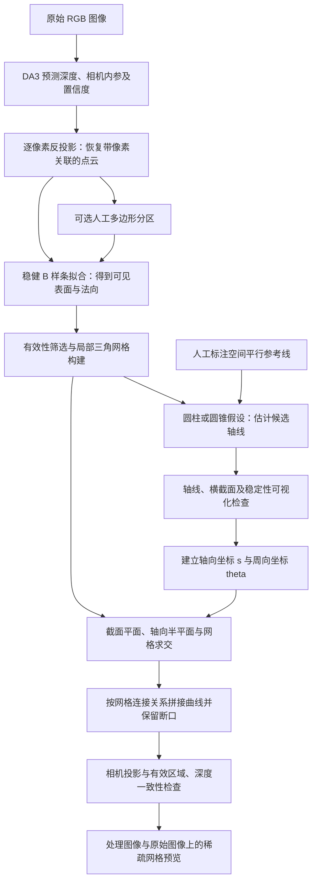

# 基于 DA3 深度的结构表面网格：当前程序工作流程

本文汇总目前已经完成的功能、数据流、运行方式和输出结果。当前继续采用的方案是：**先拟合 DA3 可见表面，再建立结构坐标，通过平面与表面网格求交生成网格线，最后投影回图像。**

当前示例图像为 `images/1920_45_000001.jpg`，相关结果位于 `outputs/1920/`。文中的示例统计来自已保存结果，不代表其他图像也会取得相同效果。

## 1. 总体流程



| 阶段 | 入口模块 | 主要输入 | 主要输出 |
| --- | --- | --- | --- |
| 深度预测与点云恢复 | `depth_anything_3.pointcloud` | 图像，或已有深度预测 NPZ | `prediction.npz`、`frame_0000.npz`、点云 PLY |
| 表面拟合与建网格 | `depth_anything_3.surface` | 像素关联点云 NPZ，可选多边形区域 JSON | `surface.npz`、`model.json`、表面网格 PLY |
| 轴线估计与验证 | `depth_anything_3.axis` | 表面 NPZ，可选人工约束 | `axis.json`、截线数据、轴线验证图 |
| 周向坐标与稀疏网格 | `depth_anything_3.grid` | 表面 NPZ、轴线 JSON | 网格叠加图、结构坐标、三维曲线与诊断报告 |

只有从图像重新运行 DA3 推理需要使用当前已验证的 CUDA 环境。读取已有预测、点云转换、表面拟合、轴线估计和网格生成均可在 CPU 上执行。

## 2. 深度预测与点云恢复

### 2.1 深度预测

程序读取单张图像或目录中的图像，调用 DA3 推理，取得深度 `depth`、相机内参 `intrinsics`，以及模型提供的置信度、外参和处理后的 RGB。

当前使用本地 `DA3-BASE` 模型，处理分辨率参数为 504。示例的原图尺寸是 **1920×1080**，模型处理图像是 **504×280**。

`prediction.npz` 保存预测数组、处理图像、源图路径和尺度标记。后续调整几何参数可以复用它，不必重新推理。

### 2.2 点云反投影

对处理图像上的像素 `(u,v)`，用深度和内参恢复三维点：

```text
P_camera = Z(u,v) × inverse(K) × [u,v,1]^T
```

其中 `Z` 是相机 z 方向的深度，不是沿单位视线的距离。默认坐标约定为：x 向右、y 向下、z 向前。

程序去掉无效深度，并支持置信度阈值、最大深度和像素采样步长。默认不删除有限的低置信度观测，以便保留原始几何供检查。

输出中保留每个点对应的 `pixels_uv`，以及 `valid_mask`、内参、颜色和可用的置信度。这些字段使后续程序能够建立局部连接并将三维结果准确回绘到处理图像。

**后续计算读取 NPZ。** PLY 主要用于三维查看，不包含完整的像素关联和相机信息。

当前结果共有 **141,120 个点**；`is_metric=false`，坐标长度使用预测单位，不能直接解释为米或厘米。

## 3. 可见表面拟合与三角网格构建

### 3.1 为什么先拟合

原始深度中的局部噪声会使平面交线抖动、回折。表面拟合用于得到更平滑的可见几何，便于生成连续网格线。

当前新增人工分区模式：`--annotate-regions` 可交互标注左右多边形，`--regions` 可读取已有 JSON。每个区域使用独立的局部参数域和样条模型，区域外不拟合，网格不跨区域连接。输出接口继续兼容后续轴线估计与网格生成，详见 [人工多边形分区域拟合](SURFACE_REGIONS.md)。未指定区域时仍执行全局拟合，下文默认参数统计属于全局方案。

当前使用**透视逆深度三次张量积 B 样条**。在处理图像上定义归一化参数 `p=u/(W-1)`、`q=v/(H-1)`：

```text
g(p,q) = Σ C[j,i] B_i(p) B_j(q)
Z_fit(u,v) = depth_scale / g(p,q)
S(u,v) = Z_fit(u,v) × inverse(K) × [u,v,1]^T
```

`depth_scale` 用于数值稳定，恢复时乘回，不改变输出尺度。这里的 `p,q` 只是图像参数，与后续结构轴向坐标 `s`、周向角 `theta` 含义不同。

拟合使用 Huber 迭代重加权最小二乘，并对控制网格的二阶差分施加平滑约束；解析求导得到表面法向。

默认控制点数量为 **16×10**，平滑系数 **0.05**，最多采样 **16,000** 个训练点。按 8×8 像素块留出约 20% 的验证区域，用于检查未参与拟合观测上的误差。

### 3.2 有效区域与网格

拟合后计算相对深度残差：

```text
relative_error = abs(Z_fit - Z_DA3) / Z_DA3
```

通过观测有效性、曲面可求值性和默认 **5%** 残差阈值的点标记为 `inlier`。该标记表示几何支持区域，不是人工或分割模型提供的左右部件掩码。

程序按图像邻接关系建立三角网格，默认每 3 像素形成一个网格单元。单元内部存在无效点或孔洞时不连接；深度跳变超过默认 **10%** 时也会阻断连接。不补全不可见表面。

当前保存结果为：拟合在第 **18** 次迭代收敛，保留 **134,098** 个拟合点，生成 **29,222** 个三角面；验证集相对深度误差中位数约 **0.445%**，95 分位约 **5.077%**。

这些误差描述拟合曲面与 DA3 预测的一致程度，不能作为真实结构的测量精度。

## 4. 轴线估计、人工约束与状态解释

### 4.1 自动估计

当前以一条直线表示结构轴线：

```text
Axis(s) = c + s × a
```

`c` 是轴线上参考点，`a` 是单位方向。程序以通过有效性检查的原始 DA3 点作为拟合观测，以拟合表面法向提供较弱的方向约束，分别尝试圆柱和圆锥假设。

通过多初值稳健优化、验证残差比较和重采样，选择并检查候选轴线。再用垂直于轴线的平面与实际有效网格求交，检查截面支持情况。

圆柱、圆锥是估计轴线的辅助假设。最终网格线来自实际拟合表面的交线，不使用理想圆环代替表面。

### 4.2 人工参考线

自动结果不理想时，可在处理图像中标注至少两条**真实空间中相互平行、且沿结构轴向的直线**。程序结合内参，从这些直线对应的视线平面估计轴向。

人工参考线主要约束**方向**；轴线的三维位置仍由点云估计。不能把二维空腔中心像素处的壁面深度作为空腔轴心深度。逐渐汇聚的锥面母线、弯曲接缝也不能直接当作空间平行线。

当前网格使用 `outputs/1920/axis_annotate/axis.json`：

```text
point     = [ 0.07304778, -0.04511980, 0.92444685 ]
direction = [-0.02963897, -0.02214305, 0.99931537 ]

manual_direction = true
manual_position  = false
status           = needs_review
```

### 4.3 needs_review 的含义

`needs_review` 表示候选轴线已经生成，但当前诊断仍有需要检查的项目。程序会检查模型残差、重采样变化、候选差异以及截面支持等，具体原因记录在对应的 `report.json` 中。

`candidate_consistent` 表示未触发当前诊断启发式，同样不等于已验证真实物理轴线。现有程序输出的 `accepted_as_physical_axis` 始终为 `false`。

这两个状态都允许继续生成预览。当前可以通过图像检查来决定是否将轴线作为绘制参考，但程序尚未实现专门的人工验收状态流转。

## 5. 周向坐标与稀疏网格预览

### 5.1 建立结构坐标

在垂直于 `a` 的平面内建立正交单位向量 `e1,e2`，定义：

```text
s      = dot(P-c, a)
x      = dot(P-c, e1)
y      = dot(P-c, e2)
theta  = atan2(y,x) mod 2π
radius = sqrt(x²+y²)
```

`s` 表示沿轴线的位置，`theta` 表示周向角。默认 `e1` 为相机 X 方向在横截面内的投影，`e2=a×e1`；周向角按绕正轴向的右手方向增加。

周向零位只是当前显示约定。可以通过 `--zero-angle-deg` 调整，或通过 `--zero-pixel U V` 指定处理图像上的有效表面参考点。

### 5.2 横向线：等距垂直平面求交

在轴向范围 `[s_min,s_max]` 内等距放置 N 个平面：

```text
s_i = s_min + i × (s_max-s_min)/(N-1)
Plane_i: dot(P-c,a) = s_i
```

每个平面的法向量为 `a`，因此平面垂直于主轴。平面与三角网格相交得到线段，再按共享网格边和顶点拼接为截面曲线。

默认使用轴线文件中的范围，放置 **5 个平面**。当前范围约为 `[-0.22024446, 0.24933285]`，相邻平面距离约 **0.11739433 个预测单位**。这是三维轴向等距，投影后的像素间距通常不相等。

### 5.3 纵向线：固定周向角的半平面求交

对每个周向角构建包含轴线的半平面，与表面网格求交，再裁剪到轴向范围。半平面仅保留正径向一侧，以区分 `theta` 与 `theta+π`。

默认生成 **12 条纵向线**，角间隔为 **30°**。周向等角度不保证表面等弧长，也不保证网格等面积。

### 5.4 曲线连接与分支

只按共享网格边、顶点连接交线，不根据空间距离随意连接不同表面。孔洞处保持断开，多分支交点处分段；平面与整个三角面共面时跳过该退化区域并记录。

程序还对每条纵向线抽样检查同一 `s,theta` 是否存在多个半径。这是几何歧义诊断，不能代替左右壁面与腹板的语义识别。

## 6. 投影、可见性检查与原图映射

曲线采样点通过相机模型投影到处理图像：

```text
[u,v,1]^T ∝ K × P_camera
```

对于当前无斜切项的内参，对应 `u=fx×X/Z+cx`、`v=fy×Y/Z+cy`。

采样采用透视正确插值，投影采样间隔最多约 0.5 个处理图像像素。要求采样位置处于有效支持区域，且三维曲线点的 z 深度与该像素的拟合深度相差不超过默认 **3%**；不满足时断开。默认丢弃投影总长度小于 **2 像素** 的片段，线宽覆盖范围也受到有效区域裁剪。

原图与处理图之间必须使用正确变换。当前单张图像可用 `--resize-only`，映射比例分别是 `1920/504` 与 `1080/280`。存在裁剪时，应使用 `--processed-to-original` 提供包含裁剪偏移的 3×3 矩阵。

可见性检查依赖当前深度和支持区域。若 DA3 未恢复线缆、灯具等遮挡物，就不能据此保证线条避开它们。

## 7. 当前结果与对比实验

当前主方案输出位于 `outputs/1920/grid/`：

- 青色：横向截面线。
- 橙色：纵向线。
- 红色：周向零位参考线。

5 个横截面在有效表面上形成 **8 段**，12 条纵向线各形成 1 段，最终保留 **20 段可见曲线**。


另做过“原始深度点云直接建网格并切片”的对比实验：141,120 个点组成 280,674 个三角面，同样的 5 个平面得到 7 段可见横向线。原始版本局部抖动较多，左侧竖向结构附近存在明显回折；当前选择继续使用拟合表面版本。

对比文件位于：

- [原始深度横线](../outputs/1920/grid_raw_sections/grid_overlay_original.png)
- [拟合表面横线](../outputs/1920/grid_fitted_sections/grid_overlay_original.png)
- [两版并排对比](../outputs/1920/grid_raw_sections/comparison.png)

上述为已保存的实验产物。当前工作区的 `grid` 入口使用 `--surface` 与 `--axis`，未提供实验中的 `--pointcloud`、`--sections-only` 参数；下文命令与当前代码保持一致。

## 8. 运行方式

以下命令在仓库根目录执行。示例使用本机已有环境；其他机器可将解释器和模型路径替换为实际路径。各阶段可以单独运行，同名输出会覆盖，参数试验应使用不同目录。

### 8.1 从图像预测并恢复点云

```bash
PYTHONPATH=src MPLCONFIGDIR=/tmp/da3-matplotlib OPENBLAS_NUM_THREADS=1 \
  /home/nvidia/venvs/da3_env/bin/python -m depth_anything_3.pointcloud \
  --images images/1920_45_000001.jpg \
  --model-dir /home/nvidia/models/DA3-BASE \
  --device cuda --process-res 504 \
  --output-dir outputs/1920/pointcloud
```

已有预测时，可用 `--prediction outputs/1920/pointcloud/prediction.npz` 替换图像、模型和设备参数，直接执行点云转换。

### 8.2 拟合表面

```bash
PYTHONPATH=src MPLCONFIGDIR=/tmp/da3-matplotlib OPENBLAS_NUM_THREADS=1 \
  /home/nvidia/venvs/da3_env/bin/python -m depth_anything_3.surface \
  --pointcloud outputs/1920/pointcloud/frame_0000.npz \
  --output-dir outputs/1920/surface
```

### 8.3 估计和检查轴线

自动估计：

```bash
PYTHONPATH=src MPLCONFIGDIR=/tmp/da3-matplotlib OPENBLAS_NUM_THREADS=1 \
  /home/nvidia/venvs/da3_env/bin/python -m depth_anything_3.axis \
  --surface outputs/1920/surface/surface.npz \
  --output-dir outputs/1920/axis
```

复用已有人工参考线，在独立目录重新生成轴线验证结果：

```bash
PYTHONPATH=src MPLCONFIGDIR=/tmp/da3-matplotlib OPENBLAS_NUM_THREADS=1 \
  /home/nvidia/venvs/da3_env/bin/python -m depth_anything_3.axis \
  --surface outputs/1920/surface/surface.npz \
  --annotations outputs/1920/axis_annotate/annotations.json \
  --output-dir outputs/1920/axis_annotate_repeat
```

新图像需要重新标注或估计轴线。可在有桌面显示的环境下，将 `--annotations 文件` 替换为 `--annotate` 打开参考线点选窗口；也可用 `--direction`、`--axis-point` 或 `--axis-json` 指定三维约束。

### 8.4 生成当前推荐的稀疏网格

以下命令直接复用已经保存的人工参考线轴线：

```bash
PYTHONPATH=src MPLCONFIGDIR=/tmp/da3-matplotlib OPENBLAS_NUM_THREADS=1 \
  /home/nvidia/venvs/da3_env/bin/python -m depth_anything_3.grid \
  --surface outputs/1920/surface/surface.npz \
  --axis outputs/1920/axis_annotate/axis.json \
  --sections 5 --sectors 12 \
  --original-image images/1920_45_000001.jpg --resize-only \
  --output-dir outputs/1920/grid
```

若使用刚生成的新轴线，将 `--axis` 指向相应目录的 `axis.json`。只调整网格数量、零位、绘制范围或线宽时，直接重跑第四步即可。

## 9. 结果目录与数据接口

```text
outputs/1920/
├── pointcloud/
│   ├── prediction.npz          # DA3 预测，可复用
│   ├── frame_0000.npz          # 像素关联点云，供第二步读取
│   ├── frame_0000.ply          # 原始点云查看
│   └── summary.json
├── surface/
│   ├── model.json             # 连续 B 样条模型
│   ├── surface.npz            # 拟合点、法向、支持标记、三角面
│   ├── surface_mesh.ply
│   ├── surface_points.ply
│   ├── diagnostics.png
│   ├── surface_3d.png
│   └── report.json
├── axis/                      # 自动轴线结果
├── axis_annotate/              # 当前采用的人工参考线轴线
│   ├── annotations.json
│   ├── axis.json
│   ├── sections.npz
│   ├── axis_overlay.png
│   ├── axis_validation.png
│   └── report.json
└── grid/
    ├── grid_overlay.png       # 504×280 处理图像预览
    ├── grid_overlay_original.png  # 1920×1080 原图预览
    ├── grid_validation.png    # 二维、三维与诊断
    ├── frame.json             # 轴向、周向基、范围和各线参数
    ├── coordinates.npz        # 每个表面点的 s、theta、radius
    ├── grid.npz               # 三维曲线、连接索引及可见投影
    ├── grid_curves.obj        # 分段三维线对象
    ├── grid_points.ply        # 可见曲线采样点
    └── report.json
```

`surface.npz` 中的逐点数组沿用输入点顺序，`faces` 索引该完整数组。`coordinates.npz` 逐点对应同一表面；`theta` 单位为弧度，实际使用时应结合 `parameter_valid` 和 `inlier`。

`grid.npz` 的第 i 段曲线由 `vertices[offsets[i]:offsets[i+1]]` 提取。`family_ids=0` 表示横向线，`family_ids=1` 表示纵向线；`line_ids` 为对应线族中的编号。带 `visible_` 前缀的数组为可见性裁剪后的版本，`visible_pixels_uv` 是处理图像坐标。

同一条线可能有多个断开的片段；相同 `line_ids` 不代表可以直接跨断口连接。当前保存的是网格曲线及其编号，尚未生成带独立单元编号的面片分区。

NPZ、轴线、内参和图像应来自同一帧。相同尺寸、相同内参不能证明它们属于同一张图；不同帧或不同推理结果不能随意混用。已有报告中的绝对路径可能记录的是目录整理前的位置，实际运行以命令指定的文件为准。

## 10. 当前能力边界与下一步

当前已完成从深度预测到稀疏网格预览的链路，支持自动或人工约束轴线、三维交线分段、有效区域裁剪、深度一致性检查和原图叠加。整条链路不要求精确分割掩码。

尚未完成的工作包括：

1. 使用新增多边形工具完成真实叶腔区域标注，验证分区拟合与截线的贴合效果。
2. 细化人工区域边界，或进一步实现左右壁面、中间腹板等部件的自动区域识别。
3. 经区域确认后修整碎片、处理可补接断口，并生成更密的正式网格。
4. 为网格单元建立编号，导出区域边界或用于后续检测定位。
5. 用已知尺寸标定物理尺度；如需等表面弧长、等面积网格，还需另行实现。

当前建议优先完成第 1 项的实际数据验证：**人工标注左右区域，检查区域预览及独立拟合结果，再用固定轴线比较截线**。先明确绘制边界，再增加密度，能更直接地检查腹板误覆盖和边界越界问题。

## 11. 代码与分步文档

| 内容 | 命令行入口 | 核心计算 |
| --- | --- | --- |
| 点云恢复 | [pointcloud.py](../src/depth_anything_3/pointcloud.py) | [utils/pointcloud.py](../src/depth_anything_3/utils/pointcloud.py) |
| 表面拟合 | [surface.py](../src/depth_anything_3/surface.py) | [utils/surface.py](../src/depth_anything_3/utils/surface.py) |
| 轴线估计 | [axis.py](../src/depth_anything_3/axis.py) | [utils/axis.py](../src/depth_anything_3/utils/axis.py) |
| 网格预览 | [grid.py](../src/depth_anything_3/grid.py) | [utils/grid.py](../src/depth_anything_3/utils/grid.py) |

各阶段的详细参数和数据约定见：[点云恢复](POINTCLOUD.md)、[表面拟合](SURFACE.md)、[轴线估计](AXIS.md)、[稀疏网格预览](GRID.md)。几何测试验证坐标转换、拟合、求交、连接和投影逻辑；实际结构精度仍需结合测量或其他观测验证。
